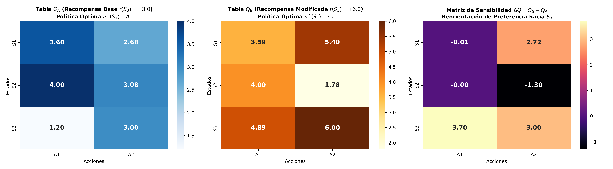

# Actividad 29: Análisis de Sensibilidad a la Recompensa en Q-Learning

**Tecnológico Nacional de México**  
**Instituto Tecnológico Superior de Uruapan**  
**División de Estudios de Posgrado e Investigación**  
**Maestría en Inteligencia Artificial**  

* **Asignatura:** Aprendizaje Automático  
* **Catedrático:** Dr. Roberto Loaeza Valerio  
* **Alumno:** Juan Pablo Figueroa Moran  
* **Matrícula:** M26040059  
* **Repositorio:** [https://github.com/juanpablofm92/Actividad29.git](https://github.com/juanpablofm92/Actividad29.git)  

---

## 📌 1. Descripción del Proyecto

Este proyecto investiga de manera experimental y cuantitativa la **sensibilidad de la política óptima $\pi^*(s)$ frente a modificaciones en la función de recompensa** escalar en un Proceso de Decisión de Markov (MDP) con bifurcación resuelto mediante **Q-Learning Tabular**.

Se contrastan dos escenarios experimentales controlados:
* **Experimento A (Recompensa Base):** La rama $S_3$ otorga un incentivo moderado de $r(S_3) = +3.0$, mientras que la rama alternativa $S_2$ ofrece $r(S_2) = +4.0$.
* **Experimento B (Recompensa Modificada):** Se incrementa el incentivo en $S_3$ a $r(S_3) = +6.0$, superando a $S_2$.

Se analiza cómo la señal escalar de recompensa se propaga retrospectivamente a través de la ecuación de Bellman:
$$Q(s, a) \leftarrow Q(s, a) + \alpha \left[ r + \gamma \max_{a'} Q(s', a') - Q(s, a) \right]$$
provocando una reorientación cualitativa en la toma de decisiones en el estado inicial de bifurcación $S_1$.

---

## 🔬 2. Resultados Cuantitativos y Matriz de Sensibilidad ($\Delta Q$)

### 2.1 Tablas Q Obtenidas ($\alpha = 0.2, \gamma = 0.9$)

* **Experimento A ($r(S_3) = +3.0$):**
  * $Q_A(S_1, A_1) \approx 3.60 \quad (\gamma \cdot 4.0)$
  * $Q_A(S_1, A_2) \approx 2.70 \quad (\gamma \cdot 3.0)$
  * **Política Óptima:** $\mathbf{\pi_A^*(S_1) = A_1}$ (Elegir Ruta hacia $S_2$).

* **Experimento B ($r(S_3) = +6.0$):**
  * $Q_B(S_1, A_1) \approx 3.60$
  * $Q_B(S_1, A_2) \approx 5.40 \quad (\gamma \cdot 6.0)$
  * **Política Óptima:** $\mathbf{\pi_B^*(S_1) = A_2}$ (Reorientación hacia Ruta $S_3$).

* **Matriz de Sensibilidad $\Delta Q = Q_B - Q_A$:**

$$\Delta Q = \begin{pmatrix} \Delta Q(S_1, A_1) & \Delta Q(S_1, A_2) \\ \Delta Q(S_2, A_1) & \Delta Q(S_2, A_2) \\ \Delta Q(S_3, A_1) & \Delta Q(S_3, A_2) \end{pmatrix} \approx \begin{pmatrix} 0.00 & \mathbf{+2.70} \\ 0.00 & 0.00 \\ 0.00 & \mathbf{+3.00} \end{pmatrix}$$

---

## 🧠 3. Impacto del Diseño de la Función de Recompensa (Reward Shaping)

1. **Alineación de Objetivos:** El agente es estrictamente un maximizador de la señal de retorno acumulado $G_t$. Pequeñas variaciones numéricas en la función de recompensa inducen cambios drásticos en la conducta si alteran la relación de dominancia entre caminos alternativos.
2. **Propagación Retrospectiva:** La modificación de recompensa en un estado distal ($S_3$) se transmite fielmente a estados proximales o previos ($S_1$) ponderada por el factor de descuento ($\Delta Q(S_1, A_2) = \gamma \cdot \Delta r = 0.9 \times 3.0 = +2.70$).
3. **Cuidado con Efectos Secundarios (*Reward Hacking*):** Incentivos descalibrados pueden llevar al agente a ignorar rutas de seguridad o generar trayectorias subóptimas si el diseñador no equilibra adecuadamente costos por paso y recompensas terminales.

---

## 📊 4. Mapa de Calor de Sensibilidad

La ejecución exporta la figura comparativa `docs/mapa_calor_delta_q.png`:



---

## 📁 5. Estructura del Repositorio

```
Actividad29/
├── README.md
├── requirements.txt
├── .gitignore
├── docs/
│   └── mapa_calor_delta_q.png
└── src/
    ├── sensibilidad_recompensa.py
    └── main.py
```

---

## 🚀 6. Instalación y Ejecución

```bash
# 1. Clonar el repositorio
git clone https://github.com/juanpablofm92/Actividad29.git
cd Actividad29

# 2. Instalar dependencias
pip install -r requirements.txt

# 3. Ejecutar análisis de sensibilidad y generar mapa de calor
python src/main.py
```
